<h1 align="center">pkp-mcp</h1>

<p align="center">
  <b>Ask Claude Code or Codex about Polish trains.</b><br>
  Connections with changes, station boards, platforms and live delays,<br>
  from the <a href="https://pdp-api.plk-sa.pl/">PKP PLK Open Data API</a>, over <a href="https://modelcontextprotocol.io">MCP</a>.
</p>

<p align="center">

[](https://github.com/V3RON/pkp-mcp/actions/workflows/ci.yml)   [](LICENSE)

</p>



## Ask it things like

- *Fastest way from Kraków to Gdańsk tomorrow before 9?*
- *Next train from Warszawa Centralna to Kraków Główny? Any delays?*
- *Departures from Poznań Główny after 18:00, intercity only.*
- *Zakopane on Saturday morning, one change is fine.*
- *Is IC 3510 running late? Which platform?*

## Tools

| Tool | What it does |
|---|---|
| `search_connections` | Trains between two stations or cities on a date, including up to 2 changes, with time window, minimum change time, category, carrier and sort options |
| `station_board` | Departures or arrivals at a station or city |
| `train_details` | One train's stops and platforms, with live delay, cancellations and disruptions; by `ref` or train number |
| `find_station` | Station and city lookup (other tools accept names directly) |

Station and city names work with or without Polish characters. A city name (e.g. `Warszawa`) covers all its
stations. Results are compact text, one line per train, with a `ref` for follow-up questions.

`search_connections` and `station_board` accept `live: true` to add current delays and cancellations
(today only, one extra request). `train_details` includes live data by default.

Data source: **PKP Polskie Linie Kolejowe S.A.**

## Requirements

- Node.js 22.13 or newer
- A free API key from <https://pdp-api.plk-sa.pl/> (Basic tier: 100 requests/hour, 1,000/day)

## Install (from a local clone)

```sh
git clone https://github.com/V3RON/pkp-mcp.git
cd pkp-mcp
pnpm install
pnpm build
```

### Claude Code

```sh
claude mcp add pkp --scope user -e PKP_API_KEY=<your key> -- node /absolute/path/to/pkp-mcp/dist/index.js
```

### Codex

Add to `~/.codex/config.toml`:

```toml
[mcp_servers.pkp]
command = "node"
args = ["/absolute/path/to/pkp-mcp/dist/index.js"]
env = { PKP_API_KEY = "<your key>" }
tool_timeout_sec = 120
```

Codex starts MCP servers with a minimal environment, so the key must be set in `env` here. The longer
tool timeout covers the first search with changes on a given date, which downloads that day's full timetable.

Keep the key in these client config files (they live in your home directory) or in a local `.env`
(git-ignored). Never commit it.

## Configuration

| Variable | Purpose |
|---|---|
| `PKP_API_KEY` | API key (required for data) |
| `PKP_MCP_CACHE_DIR` | Cache location (default: `~/.cache/pkp-mcp`, `~/Library/Caches/pkp-mcp` on macOS, `%LOCALAPPDATA%\pkp-mcp\Cache` on Windows) |
| `PKP_MCP_LOG=debug` | Verbose logs on stderr |

Behind an HTTP proxy, also set `NODE_USE_ENV_PROXY=1` so Node's `fetch` uses `HTTPS_PROXY`.

## Caching

Responses are cached in a SQLite file shared by every client on the machine, so repeated questions do
not use up the request quota:

- the station and city catalogue (2 requests) is kept for 30 days;
- each origin/destination pair or station board costs 1 request per date, reused until the published
  timetable changes (checked at most once an hour);
- journeys with changes need the whole network's timetable for the date: one larger request (tens of MB),
  made only when direct trains are not enough; after that every search for that date is answered locally;
- filters and time windows are applied locally, so asking the same question differently is free;
- live delays are cached for a minute and disruptions for 15 minutes;
- looking a train up by number (instead of a `ref`) needs that date's full network timetable;
- if the API is unreachable, older cached data is served with a note;
- when less than 10% of the hourly or daily quota is left, live data is skipped so timetable searches keep
  working (limits assumed to be the Basic tier unless the API reports remaining quota).

## CLI

```sh
node dist/index.js status            # cache and request usage
node dist/index.js status --remote   # also asks the API about your key
node dist/index.js clear-cache
```

## Development

```sh
pnpm test        # unit and end-to-end tests (no API key needed)
pnpm typecheck
pnpm lint
pnpm gen:api     # regenerate src/api/generated.ts from docs/api/openapi.json
```
